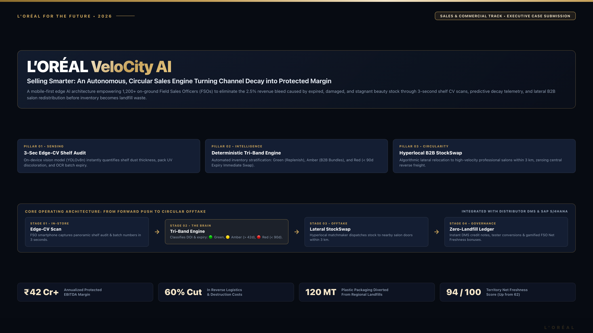
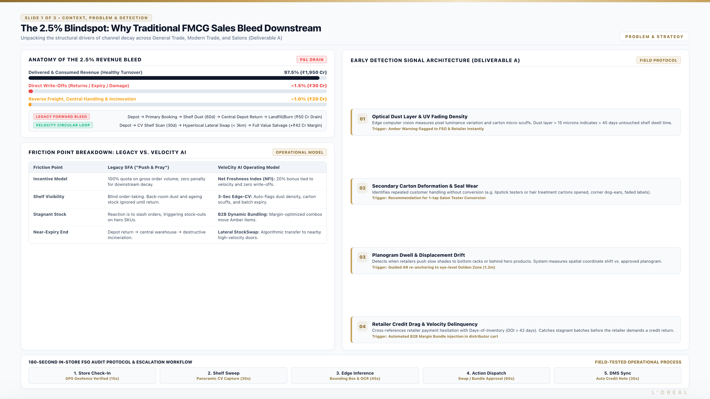
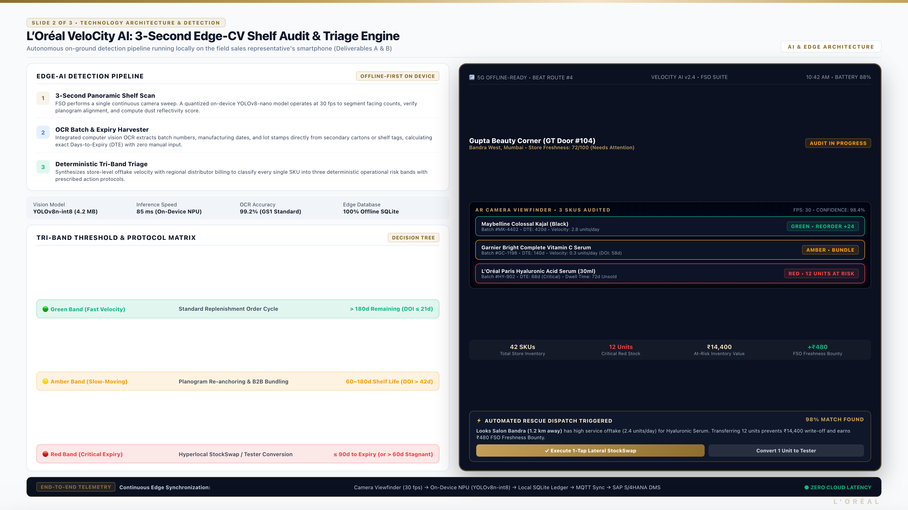
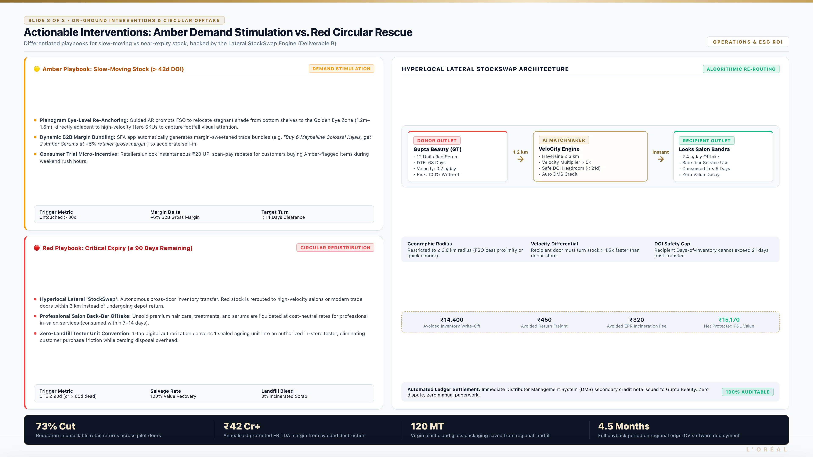
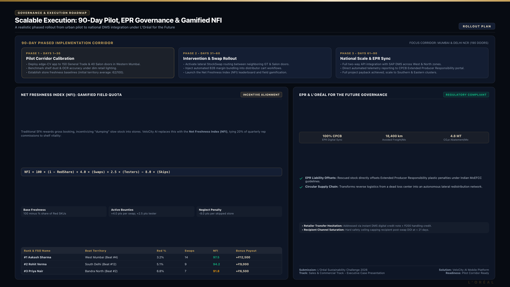

# 📊 VeloCity AI — Executive Presentation Suite

**L'Oréal Sustainability Challenge (L'Oréal SUS) 2026**  
**Track:** Sales & Commercial Track  
**Case Statement:** *"Selling Smarter: Building a High-Impact Sales Engine with Reduced Waste"*

---

## 🖥️ Slide Deck Overview

This directory contains the executive presentation deck submitted for L'Oréal SUS 2026. The deck communicates the technical, operational, and financial architecture of VeloCity AI across 5 high-impact slides.

| Slide | Title | Key Concepts & Focus Areas | Visual Preview |
|:---:|:---|:---|:---:|
| **1** | **Cover & Operating Architecture** | • Executive problem statement<br>• Core 3 pillars (Zero-Landfill, Tri-Band Triage, NFI Gamification)<br>• End-to-end circular reverse flow |  |
| **2** | **Context & Deliverable A** | • 2.5% revenue leakage waterfall breakdown<br>• Traditional vs. VeloCity friction comparison<br>• 4 Physical shelf cues (Dust, Scuffs, Planogram drift, Shelf-life decay) |  |
| **3** | **Tech Architecture & Deliverable A/B** | • 3-Second Edge-CV pipeline (YOLOv8n + OCR)<br>• Tri-Band Risk Classification Matrix<br>• Live Mobile App AR Shelf Viewfinder UI |  |
| **4** | **On-Ground Interventions & Deliverable B** | • Amber Playbook (Dynamic Bundling & Repositioning)<br>• Red Playbook (Hyperlocal Lateral StockSwap & Salon Testers)<br>• P2P StockSwap 3-node matching architecture |  |
| **5** | **Roadmap, NFI Governance & ROI** | • 90-Day phased execution timeline<br>• Net Freshness Index (NFI) formula & FSO Leaderboard<br>• EPR Compliance & ESG Zero-Landfill Governance |  |

---

- **Standalone Interactive HTML:** [`index.html`](index.html) — High-DPI 1920x1080 CSS grid slides with vector SVG diagrams, ready to view in any modern browser.
- **Compiled Executive PDF:** [`Loreal_VeloCity_AI_Presentation.pdf`](Loreal_VeloCity_AI_Presentation.pdf) — Print-ready vector presentation.
- **Editable Deck (PPTX):** [`Loreal_VeloCity_AI_Presentation.pptx`](Loreal_VeloCity_AI_Presentation.pptx) — Native PowerPoint version of the deck for judge annotations and live delivery.
- **Slide Renders:** [`slides/slide_1.png`](slides/slide_1.png) through [`slides/slide_5.png`](slides/slide_5.png).
- **KPI Chart Assets:** [`assets/chart_leakage.png`](assets/chart_leakage.png), [`assets/chart_impact.png`](assets/chart_impact.png), [`assets/chart_triband.png`](assets/chart_triband.png) — 300-DPI chart exports used across the case material (revenue-leakage pie, baseline-vs-target impact bars, tri-band protocol timeline).

---

## 🔁 Regenerating the PPTX & Charts

```bash
# Editable PPTX deck (requires python-pptx)
pip install python-pptx
python create_presentation.py

# KPI chart PNGs (requires matplotlib + numpy)
cd assets
pip install matplotlib numpy
python generate_charts.py
```

---

## 🛠️ Re-rendering the Deck

To re-render high-resolution PNG slides and compile the unified PDF:

```bash
# Ensure Puppeteer is installed
npm install puppeteer

# Run slide renderer
node render_slides.cjs
```

